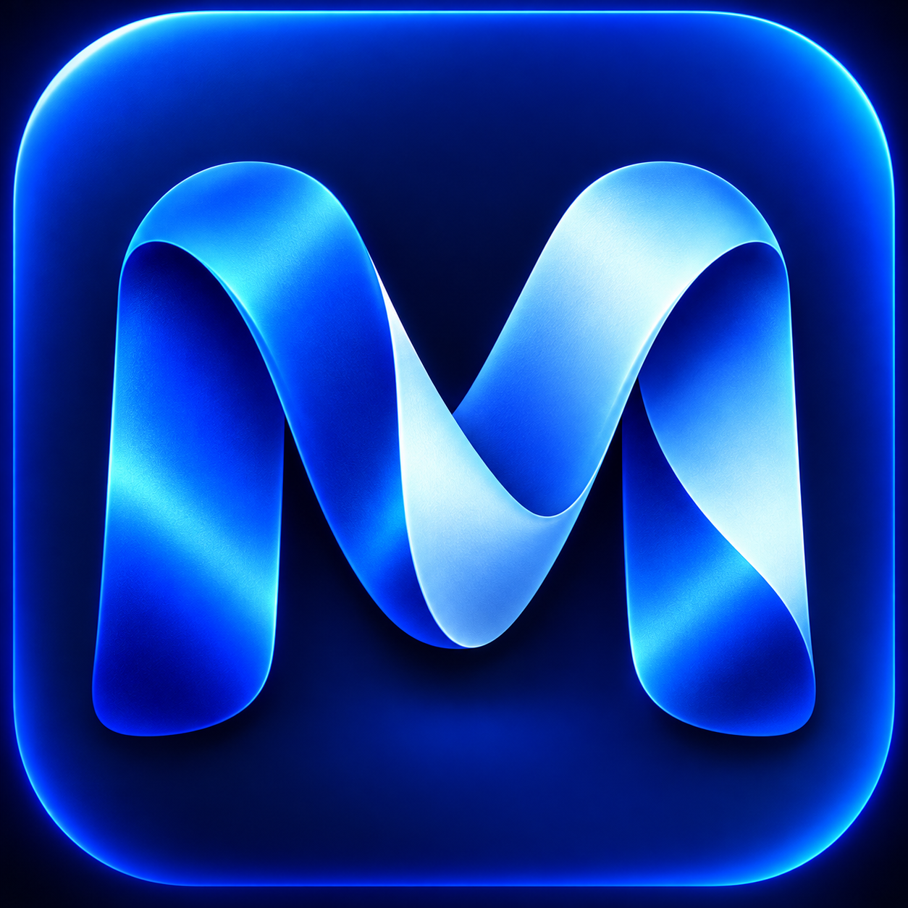
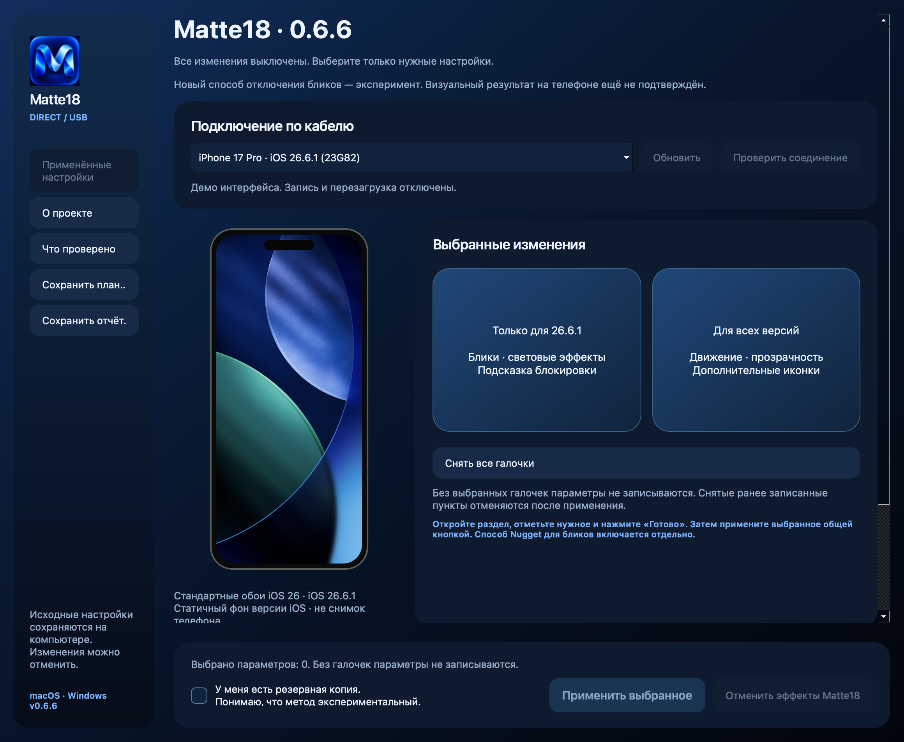

# Matte18

Настройки оформления iPhone с компьютера. **Бета-приложение для macOS и Windows.**

## Последняя версия: 0.6.8 Beta

[Описание релиза и все файлы](https://github.com/rassohinar7-dotcom/Matte18/releases/tag/v0.6.8)

| Платформа | Скачать |
|---|---|
| macOS | [ZIP](https://github.com/rassohinar7-dotcom/Matte18/releases/download/v0.6.8/Matte18-0.6.8-Mac.zip) |
| Windows x64 | [EXE](https://github.com/rassohinar7-dotcom/Matte18/releases/download/v0.6.8/Matte18-0.6.8-Windows-x64.exe) |
| Исходники | [Source.zip](https://github.com/rassohinar7-dotcom/Matte18/releases/download/v0.6.8/Matte18-0.6.8-Source.zip) |

Python включён. На Windows для USB нужны драйверы Apple.

## Что нового

**Кастомное стекло:** экспериментальный пресет для 26.6.1 / 23G82. Включает найденные флаги усиленного рассеивания и фонового фильтра, выключает найденные флаги бликов, внешнего преломления, контуров и оттенка. Выключен по умолчанию. Снятие галочки и применение возвращают исходные значения. Серый резервный материал не включается. Системный максимум размытия и удаление абсолютно всех остальных слоёв не подтверждены; произвольные радиусы не записываются.

**Прогресс:** закреплённая полоса 0–100% и подпись текущего этапа. Используются завершённые этапы, число проверенных иконок и проценты передачи от iOS. Нет роста по таймеру. При ошибке 100% не показывается. Завершение операции приложения не означает подтверждение внешнего вида или окончания загрузки телефона.

**AirTraffic на Windows:** исправлена загрузка встроенных библиотек в отдельном процессе. Ошибки импорта больше не скрываются за «синхронизация не подтверждена»; вывод содержит этап и причину, обмен использует UTF-8. Отсутствие драйверов Apple и реальные отказы службы iOS этим не устраняются.

Сохранены исправления продолжения оборванной доставки иконок и первого чтения списка настроек из 0.6.7. Старые журналы не удаляйте — они нужны для восстановления.

## Возможности

Две плитки открывают сгруппированные настройки. Параметры выключены по умолчанию и применяются по галочкам. «Применённые настройки» читает известные переопределения из шести файлов, в том числе оставленные GoldenNugget; позволяет отменять выбранные значения с повторным чтением перед записью. Источник записи и прежние значения чужих программ определить нельзя: отмена удаляет переопределение и возвращает выбор iOS.

Светлые иконки создаются как дополнительные WebClip-ярлыки, а не заменяют исходные системные иконки. Новые визуальные эффекты и появление ярлыков на реальном устройстве требуют проверки.

## Проверки и совместимость

202 автоматические проверки прошли. Mac и отдельный помощник AirTraffic проверены запуском. [Проверки Windows](https://github.com/rassohinar7-dotcom/Matte18/actions) проверяют опубликованный пакет, встроенные библиотеки, изолированный помощник и запуск окна без подключения телефона. Это не проверка применения к реальному iPhone.

- macOS 14.4+, Intel runtime; на Apple Silicon нужна Rosetta.
- Windows 10 1809+ x64 и Windows 11 x64 с драйверами Apple.
- Управляемое стекло и просмотр настроек: модели iPhone на iOS 26.6.1 / 23G82. Визуальный результат на каждой модели не подтверждён.
- Подсказка блокировки: модели с жестовым управлением. Общие USB-параметры: профиль 26.6.1–27.0.1 с проверкой доступа перед записью.

## Ограничения

Полный возврат iOS 18, старая анимация разблокировки с прямой кромкой и постоянно горящая полоска внутри приложений не реализованы. Полное исчезновение бликов не подтверждено. Сохранение прыгающей подсказки после перезагрузки подтверждал пользователь; это не подтверждает другие эффекты.

Перед изменениями сделайте собственную резервную копию. Восстановление выбранных файлов может вызвать экран настройки iOS; сохранение пары Apple Watch не подтверждено. Приложение автоматически не отключает шифрование.

## Лицензии

AGPL-3.0. Полный код и сторонние лицензии включены в Source.zip соответствующего релиза. Основано на исследованиях Nugget/GoldenNugget и Airlift; это отдельный проект. См. LICENSE и NOTICE.md.
